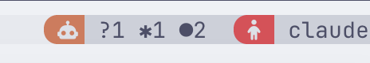
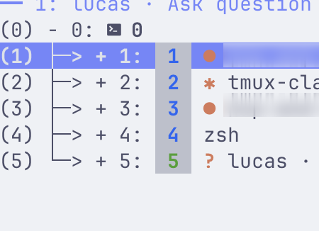

# tmux-claude-status

Show the live status of your [Claude Code](https://claude.com/claude-code)
sessions in tmux: every window gets a badge (status bar and `choose-tree`
window picker) telling you whether Claude is working, waiting for your
decision, idle, or stopped on an error — plus a global summary and a
shortcut to jump straight to the session that needs you.

| Status | Badge (default) | Meaning |
|---|---|---|
| working | `✻` animated, orange | Claude is processing a prompt / running tools |
| need input | `? 3m` bold orange | Claude is waiting for a permission — with waiting time |
| waiting | `●` orange | Turn finished, Claude waits for a prompt |
| error | `✗` red | Claude stopped on an error (StopFailure) |

**Subagent permissions.** A permission requested by a subagent (e.g. `Bash
command · from the Explore agent`) does not replace the main-loop glyph —
the main loop is still orchestrating. Instead a count is appended: `✱?` for
one pending subagent permission, `✱?²` for two, etc. (the `?` is always
orange). A plain `?` (no leading glyph) remains a main-thread permission.

Windows without a Claude session show nothing. The waiting badge **ages**:
`●` shrinks to `•` after 5 minutes and to a dimmed `·` after 30 minutes,
so sessions you have not checked in a while fade out visually.

## Screenshots

Global summary pill and session flavor in the status bar:



Per-window badges in the `choose-tree` window picker:



## How it works

**Claude Code hooks** (`settings.json`) call `scripts/claude-status-hook.sh`
on every event. The script sets tmux user options:

- `@claude_pane_status` (pane) — pane status
- `@claude_pane_status_since` (pane) — epoch of the last change
- `@claude_pane_pid` (pane) — claude process PID (for liveness)
- `@claude_pane_flavor` (pane) — config dir name (`claude`, `claude-work`, …),
  handy because the Claude Code binary is named after its version number
- `@claude_pane_subagents` (pane) — `agent_id:epoch` set of subagents currently
  blocked on a permission; `@claude_pane_subq_disp` — its rendered suffix
- `@claude_win_status` (window) — aggregate, priority
  `need_input` > `error` > `working` > `waiting`
- `@claude_win_subq` / `@claude_win_subq_disp` (window) — pending subagent
  permission count and its rendered suffix

**Companion daemon** (`scripts/claude-status-daemon.sh`) — started on demand
by the hook, **child of the tmux server** (spawned via `run-shell -b`, dies
with it), single instance (mkdir lock), exits by itself when no Claude
session remains. It handles everything that needs time or computation:

- **animation**: `@claude_spinner_frame` advances at ~2.5 fps while ≥1
  window is working AND ≥1 client is attached
- **liveness**: one batched `ps` per sweep (~5 s) checks that each
  `@claude_pane_pid` is alive **and** on its pane's tty (robust against
  kill -9 and PID reuse); otherwise clears the status
- **durations**: `@claude_win_wait` (“3m”) for need_input windows
- **subagent counters**: expires stale `@claude_pane_subagents` tokens
  (backstop for a missed decrement) and refreshes the per-pane/window suffixes
- **global summary**: `@claude_status_summary` (“?1 ✗1 ✱3 ●2”),
  counted per window, zeros omitted; the `?` count folds main-thread
  need_input **and** pending subagent permissions

**Badges** are composed by `claude-status.tmux`; reference them with
`#{E:...}`: `@claude_badge_win`, `@claude_badge_pane`,
`@claude_badge_summary`.

**No phantom working**: only `UserPromptSubmit` (a genuine turn start) moves
a session from `waiting` to `working`. Tool events
(`PreToolUse`/`PostToolUse`/`PreCompact`) set a “soft” working that never
overrides a `waiting` — essential because hooks run in parallel and these
events can arrive after the end-of-turn `Stop` (background agents run tools
too).

**No phantom need_input**: `need_input` comes from `Notification`
(`notification_type=permission_prompt`), which only fires when the question
actually reaches the user — NOT from `PermissionRequest`, which fires for
every request including ones auto-approved by another hook (a long tool
would keep a phantom `?` for its whole duration).

**Subagent permissions** are told apart from main-thread ones by the
`agent_id` field Claude Code adds to a hook's JSON when it fires inside a
subagent. A `permission_prompt` **with** `agent_id` increments a per-pane
counter (`@claude_pane_subagents`) instead of touching the main-loop status,
so the daemon's activity heuristic can never erase it. The counter is
decremented when that subagent's next tool event (`PreToolUse`/`PostToolUse`)
or its `SubagentStop` fires; the end-of-turn `Stop` clears any remainder, and
the daemon expires stale tokens as a last resort.

## Installation

### With TPM

```tmux
set -g @plugin 'farnots/tmux-claude-status'
```

Press `prefix + I` to install. Load it **after** your theme (e.g. catppuccin)
so the plugin inherits its colors.

### Manual

```sh
git clone https://github.com/farnots/tmux-claude-status ~/.tmux/plugins/tmux-claude-status
```

```tmux
# in ~/.tmux.conf, ideally AFTER catppuccin (inherits @thm_red for errors)
run-shell ~/.tmux/plugins/tmux-claude-status/claude-status.tmux
```

### Wire up the Claude Code hooks

Merge the blocks from
[`examples/claude-settings-hooks.json`](examples/claude-settings-hooks.json)
into the `hooks` section of `~/.claude/settings.json` (append at the end of
each event array, without touching your existing hooks — hooks of the same
event run in parallel). The `SubagentStop` block is what keeps the subagent
permission counter accurate.

⚠️ Already-open Claude sessions pick up new hooks only after a restart.

### Show the badges wherever you like

```tmux
# Window list (catppuccin example):
set -g @catppuccin_window_text "#{E:@claude_badge_win}<your existing format>"
set -g @catppuccin_window_current_text "#{E:@claude_badge_win}<your existing format>"

# Vanilla window-status-format:
set -g window-status-format " #I: #{E:@claude_badge_win}#W "

# Global summary at the head of status-right (auto-renders as a catppuccin
# "pill" when the theme is loaded, plain orange text otherwise):
set -g status-right "#{E:@claude_badge_summary}<your existing status-right>"

# choose-tree (prefix+w) — window and pane branches:
bind w choose-tree -Zw -F "#{?pane_format,#{E:@claude_badge_pane}...,#{?window_format,#{E:@claude_badge_win}...,...}}"
```

## Customization

Set these **before** the plugin's `run-shell`:

```tmux
set -g @claude_status_color "#D97757"        # Claude orange (default)
set -g @claude_status_error_color "red"      # default: catppuccin @thm_red, else ANSI red
set -g @claude_status_icon_working "✱"       # static fallback when no animation
set -g @claude_status_icon_need_input "?"
set -g @claude_status_icon_waiting "●"
set -g @claude_status_icon_waiting_old "•"    # waiting for > 5 min
set -g @claude_status_icon_waiting_stale "·"  # waiting for > 30 min (dimmed)
set -g @claude_status_waiting_old_secs 300    # aging thresholds (seconds)
set -g @claude_status_waiting_stale_secs 1800
set -g @claude_status_subq_stale_secs 1800    # drop a pending subagent
                                              # permission after this (backstop)
set -g @claude_status_icon_error "✗"
set -g @claude_status_summary_icon "..."     # default: nerd-font robot
set -g @claude_spinner_frames "✻ ✳ ✶ ✱"     # animation frames, space-separated
set -g @claude_status_jump_key "C"           # prefix+C → next need_input window
                                             # (then error), cycling; empty = no binding
```

## Known limitations

- An already-open `choose-tree` does not refresh (no animation nor status
  changes); it is up to date each time it opens.
- Animation pauses when no client is attached (nothing to animate).
- After a `kill -9` of claude, the badge disappears at the next daemon sweep
  (≤ ~5 s), not instantly.
- The `? 3m` duration refreshes at sweep pace (~5 s).
- If you answer a permission prompt and the following tool runs for a long
  time, the `?` can persist until that tool's `PostToolUse` fires.

## Requirements

- tmux ≥ 3.4 (pane-scoped user options, `pane-exited`/`after-kill-pane` hooks)
- Claude Code with hooks support
- No dependencies (POSIX sh, sed, awk, ps)
- A [Nerd Font](https://www.nerdfonts.com/) for the default summary icon and
  powerline separators

## License

[Apache 2.0](LICENSE) — attribution required (see [NOTICE](NOTICE))
